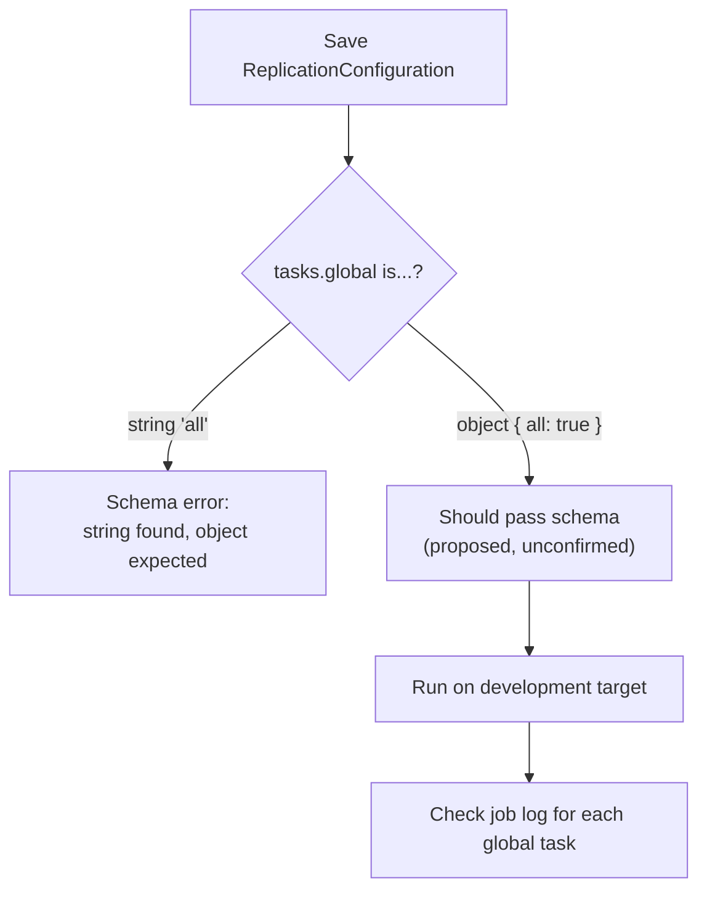

You open the `ExecuteDataReplication` job step, you want every global setting replicated, and you save the configuration. Business Manager answers with this:

```text
Invalid parameter [ReplicationConfiguration]! JSON does not match to schema: 'JSON schema processing finished with: failure --- BEGIN MESSAGES --- error: /data_replication_configuration/tasks/global: string found, object expected --- END MESSAGES --- '
```

If you landed here by pasting that error into a search engine, you are in the right place. Let us have a look at what went wrong, and what to try instead.

First, the background. Data replication in SFCC copies data (catalogs, preferences, and so on) from the staging instance to another instance, usually production. The `ExecuteDataReplication` job step runs that copy from a job instead of from the Business Manager replication screens, and you tell it what to copy with a JSON configuration. The `global` part of that configuration covers the tasks that are not tied to a single site, such as `csc_settings` and catalogs.

> [!WARNING]
> The fix in this post is **not confirmed**. It fits the error message and the object pattern used elsewhere in the documented configuration, but the schema is not published and nobody has yet shown from job logs that every global task ran. I have not run it against a development or production instance myself either: as a partner I cannot start a replication on a customer's environment just to try something, and partners do not get a PIG (primary instance group) of their own to experiment on. Replication always runs from the staging instance, so point your first test at the `development` target, never production.

## TLDR; Proposed Solution

Replace the string with an object, which is a JSON value wrapped in curly braces. Proposed and unconfirmed, so verify before production:

```json
{
    "data_replication_configuration": {
        "target": "development",
        "type": "transfer_and_publish",
        "description": "Full global data replication",
        "cache_invalidation": "clear_all",
        "tasks": {
            "global": { "all": true }
        }
    }
}
```

> [!NOTE]
> As of 16 October 2026 this is unconfirmed. I have not found a report from job logs that `"global": { "all": true }` saves and replicates every global task. I will update this note when someone does.

## What the Docs Say, and What They Leave Out

The [Job Step API documentation for ExecuteDataReplication](https://salesforcecommercecloud.github.io/b2c-dev-doc/docs/current/jobstepapi/html/api/jobstep.ExecuteDataReplication.html) describes a single parameter, `ReplicationConfiguration`, that "requires a string in JSON format". Tasks you leave out of that JSON are not part of the process.

> [!NOTE]
> The older `documentation.b2c.commercecloud.salesforce.com` address now redirects to this `b2c-dev-doc` GitHub Pages copy. Same page, new home, so old bookmarks still land in the right place.

Under `tasks.global`, the page says: "Global data replication tasks. To process all tasks, use the keyword 'all', otherwise use these:", followed by a list of tasks such as `csc_settings`.

So you write `"global": "all"`. It is the obvious reading. But the page never shows the JSON shape for that keyword, and no schema is linked. A schema is the formal description of which shapes a JSON document may have, and it is what Business Manager checks your configuration against.

The same page uses `all` in other places. For catalogs, libraries, price books and sites, it describes `all` as an ID (which suggests an object key) or `true` at that level. Preferences and storefront URLs are described as `all` or `true`, and the tasks of a single site as "the keyword 'all'", without showing the JSON shape for any of them. The `global` group is the one place where I know the documented wording and the validator disagree. The other bare-keyword mentions may have the same problem, and I have not tested them.

## The Failing Attempt

This is the configuration that fails, verbatim:

```json
{
    "data_replication_configuration": {
        "target": "development",
        "type": "transfer_and_publish",
        "description": "Full global data replication",
        "cache_invalidation": "clear_all",
        "tasks": {
            "global": "all"
        }
    }
}
```

Business Manager checks the JSON syntax and the replication tasks when you save the step in the job configuration. That is why you see this error at save time, before the job ever runs. Passing validation is not a guarantee, though: the docs add that if something is wrong, a log message is written at runtime.

## How to Read "string found, object expected"

Take the error one piece at a time:

- **`/data_replication_configuration/tasks/global`:** the path to the offending value.
- **`string found`:** you supplied `"all"`, which is a string (text in quotes).
- **`object expected`:** the schema wants `{ ... }` at that position, a set of named values inside curly braces.

So the documentation says "use the keyword 'all'" without saying what shape that keyword takes, while the validator wants an object at `tasks.global`. Somebody has to bridge that gap, and I could not find a published schema to do it. That is a common stumbling block here.

## The Proposed Fix: { "all": true }

A community member recalled from past experience that the format is `"global": { "all": true }`. They had not re-verified it.

It is a sensible guess, for three reasons:

1. It satisfies the error message, because it is an object.
2. It matches the way individual tasks are configured, with a task name as the key and `true` as the value, meaning "include this task".
3. The documentation itself uses `true` as the "everything at this level" value in other places, for example preferences and sites.

A related guess, `"global": true`, follows the same "true at the level" pattern. It is not documented for `global`, and I have not tested it.

Here is where the evidence runs out. The original poster found `{ "all": true }` logical and planned to use it, but the replication was scheduled for later, so there is no confirmation that the configuration saved or that all tasks were included in the run. No follow-up exists yet. I have not found anyone reporting from job logs that every global task ran.



## Selective Replication Uses the Same Object Shape

A community example, shared as a usage sample for a custom wrapper job called `DoDataReplication`, selects a single catalog with an object under `global`:

```bash
b2c job run DoDataReplication \
    --server example.com \
    --wait \
    -P 'ReplicationConfig={"data_replication_configuration":{"target":"production","type":"transfer_and_publish","description":"Replicate NTO Electronics catalog to production","cache_invalidation":"keep_all","tasks":{"global":{"catalogs":{"nto-electronics":true}}}}}'
```

**[VERIFY]** The source only shows this as an example. I have not run it.

This example sends the configuration to a custom job through a command-line tool, which is one way to trigger a job from outside Business Manager. Two things to keep apart:

- **Different jobs:** `DoDataReplication` is a custom job from a community gist, not the built-in step.
- **Different parameter names:** the wrapper takes `ReplicationConfig`, while the built-in step takes `ReplicationConfiguration`.

The useful part is the shape. `tasks.global` is an object, and task keys are set to `true` or to nested objects. That supports the `{ "all": true }` form, but it does not prove it.

| Approach | `tasks.global` value | First check |
| --- | --- | --- |
| Everything global (proposed) | `{ "all": true }` | Does it save? Does the log list every global task, `csc_settings` included? |
| One catalog | `{ "catalogs": { "nto-electronics": true } }` | Does only that catalog show up in the log? |
| String keyword (fails) | `"all"` | Schema error at save time |

The docs list the other global task keys, such as `csrf_whitelists`, `geolocations` and `static_content`, but the catalog example above is the only object-shaped `global` value I have seen used. Watch the spelling, too: for the site-level tasks the docs list `ab_tests_and_experience` in the parameter list but `ab_tests_and_experiences` in the example JSON, so check the exact spelling before you rely on either.

> [!WARNING]
> The official example JSON contains a trailing comma (after `"master" : "exclude-static"`), so it is not strictly valid JSON. Do not paste it into the job step as it is.

## Automating It

Replications that nobody notices failing are a known pain point, and running them through jobs is one way to keep an eye on them. Jobs can be scheduled, triggered over an API or from the command line, and monitored. The API route used to mean OCAPI (the Open Commerce API), but Salesforce marked it as [deprecated in April 2026](/in-the-ring-ocapi-versus-scapi/), so new work belongs on the SCAPI Jobs API. Community tips: use the failure notification, and write log entries that a monitoring system can flag. The step has that notification built in: the documented `notification` object takes a `type` of `process_end`, `process_error` (sent only when the process does not succeed) or `periodically`, plus a `to` list of recipients.

Two community code samples are worth reading. I have not been able to open them, so I will not describe their code. Review it yourself before reusing anything:

- [Triggering ExecuteDataReplication via OCAPI](https://gist.github.com/clavery/2a7370293db35309b3e186f47c3bd76f), supplying the replication configuration dynamically when calling the job (the gist page is dated December 2023).
- [A custom DoDataReplication job](https://gist.github.com/clavery/61b3e2fee948405b42b0d84433fe5a4e) that runs the `ExecuteDataReplication` step, takes a fairly complex JSON input (the step needs JSON), and shows how to wait for the replication to finish (shared August 2025). Both samples call the OCAPI Data API.

For the API route you need working authentication first; see [how to set up OAuth JWT for the OCAPI](/how-to-setup-oauth-jwt-for-the-ocapi/), which also applies to SCAPI Admin clients. The SCAPI Jobs API wants the `sfcc.jobs.rw` scope to start an execution, while the OCAPI route needs a POST permission on `/jobs/*/executions` in Open Commerce API Settings. And if you want to write your own job steps, [Mastering Chunk-Oriented Job Steps in SFCC](/mastering-chunk-oriented-job-steps-in-salesforce-b2c-commerce-cloud/) covers the chunk-oriented kind. Running replication as a job also lets you order follow-up work after it, which is the ordering [the sitemap guide](/mastering-sitemaps-in-sfcc/) recommends for the sitemap job.

### "Job Not Found" via the API

If the API answers "job not found" for a custom job, there are two possible causes, offered from experience rather than from documentation. Both concern jobs built on custom step types, not the built-in `ExecuteDataReplication` step:

- **Code version:** a custom step type used by the job is not loaded on the active code version. The job stays visible in Business Manager but looks "not found" to the API, presumably because the platform treats it as invalid.
- **Job error:** the job has an error or is missing a required parameter. The latter may give a better error message.

In the observed case, switching and re-activating the code version fixed it.

## Verify It Yourself

Do not trust this post, or anyone's memory, over your own job log.

1. Create the job with the step on your staging instance, because replication processes only run from staging. Point the `target` at `development` if you have one, and keep production out of your first test. A developer or on-demand sandbox cannot receive replicated data.
2. Paste the proposed JSON into the `ReplicationConfiguration` parameter and save. If the schema error disappears, that is the first half confirmed.
3. Run the job. Even against `development`, `transfer_and_publish` overwrites the selected data on the target.
4. Open the job log and the replication logs (Administration > Site Development > Development Setup > Log Files; the files are named like `staging-...-appserver-yyyymmdd.log`, on both the staging and the target instance). Look for evidence that each global task, for example `csc_settings`, `csrf_whitelists` or `geolocations`, was processed. The docs list the full set under `tasks.global`. I have not seen what a successful run looks like there, so I cannot tell you the exact wording to search for.
5. Check the replication history under Administration > Replication > Data Replication. Replications older than 180 days no longer show there, as covered in [the 23.1 release notes](/salesforce-b2c-commerce-cloud-23-1/).

> [!NOTE]
> There is no log excerpt here yet. Nobody has shown me a run where every global task was processed. Once someone does, it goes in this spot.

One docs detail is worth knowing while you read the log. Tasks set to `false` are not included, "However, this only applies if the keyword 'all' is not used", which suggests `all` overrides per-task `false` values. That is a reading of the docs, not something I tested.

## Safety Settings Before You Run It

`target` and `cache_invalidation` deserve a second look, because a wrong value costs more than a schema error.

- **`target`:** the instance that receives the data. The docs list `production` and `development`. Run your first test against `development`.
- **`cache_invalidation`:** `clear_impacted_partitions`, `clear_all` or `keep_all`. The older `keep_caches` is deprecated, and `cache_invalidation` takes precedence. If neither is set, caches are cleared.
- **Transfer and publish:** the `type` value `transfer_and_publish` transfers the data to the target and immediately replaces the existing data there. If you split it into `transfer` and `publish`, [Trailhead](https://trailhead.salesforce.com/content/learn/modules/b2c-admin-replication/b2c-admin-configure-data-replication) says the publish must match the transfer's tasks exactly, or it fails.
- **Custom caches:** the [custom caches guide](https://developer.salesforce.com/docs/commerce/b2c-commerce/guide/b2c-custom-caches.html) says custom caches are cleared at the end of data replications, as covered in [the custom cache field guide](/field-guide-to-custom-caches-in-sfcc/). It does not say whether `keep_all` changes that, so do not count on it sparing them. Leaving `cache_invalidation` out clears caches anyway, and Salesforce notes that cache clears can hurt performance during high traffic. On a busy production storefront, pick the value and the time of day on purpose.

## Checklist

- The string `"global": "all"` is replaced by an object.
- The configuration saves without a schema error.
- The first run used the `development` target, not production.
- The job log shows every global task, `csc_settings` included, as processed.
- `target` and `cache_invalidation` were chosen on purpose.
- You have a log excerpt or screenshot of the run to share.

If you run it, share what your job log shows, whether it confirms the object form or not, so the note under the TLDR can be updated. Until someone posts log evidence, treat the object form as unverified.
