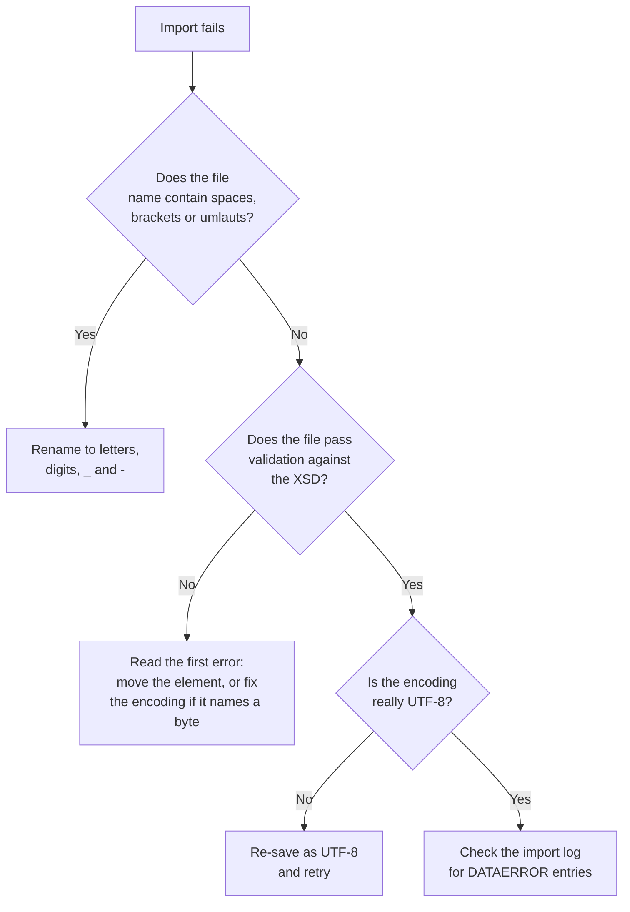

A colleague exports a catalog, tweaks a few products, and uploads the result through Business Manager (the admin UI of B2C Commerce, BM for short). The import fails. The XML looks fine, the data looks fine, and the only visible change since last week is that the file is now called `import file (3).xml`.

Welcome to the small, plain corner of B2C Commerce where files are rejected for reasons that have little to do with whether your data is right. This post collects three of those quirks: element order in the XML, special characters on the way in and out, and a file name that, in my testing, is a tad fussier than it looks.

Salesforce documents some of this and not all of it. I will say which parts come from the official Help pages, which come from my own testing, and which are general XML knowledge.

## Imports Are Checked Against a Schema

Imports and exports in B2C Commerce (often called impex) move data as XML files. B2C Commerce [only accepts XML import files that conform to its schema files](https://help.salesforce.com/s/articleView?id=cc.b2c_file_formats.htm&language=en_US&type=5): `catalog.xsd`, `customer.xsd`, `order.xsd`, `pricebook.xsd`, `coupon.xsd` and friends. An XSD is an XML Schema Definition: a file that lists which elements a document may contain, in which order, and with which types. CSV is no longer accepted for imports, and the one CSV exception on the export side is coupon codes.

When you import manually in Business Manager, the file is validated against the schema automatically. A custom pipeline (the older, visual way of writing server-side flows) has to include the `ValidateXMLFile` pipelet, a ready-made pipeline step, to get the same check, and then read its status, because the pipelet carries on even when the file is invalid. If you have ever wondered why a hand-rolled feed that Business Manager rejects sails through your own pipeline, that may be the missing piece.

Validation is only half the story. Most schemas mark their elements as optional, and the platform does not validate dependencies between them, with a few exceptions. A category assignment that points to a category that does not exist does not fail the file. It is ignored and written to the log, so a successful import does not prove every row landed.

That split matters when you triage. A file that violates the schema fails as a whole. A file that is schema-valid but semantically odd gets through, and you find out in the log.

## XML Element Order

Here is the quirk that sends people hunting. In an XSD, an element definition that uses `<sequence>` demands its child elements in exactly the declared order. So a perfectly good value in the wrong position is still invalid, because the validator checks position as well as content.

The Salesforce Help pages I checked do not describe sequence ordering explicitly. They do say that category and product elements in a catalog can appear [in any order](https://help.salesforce.com/s/articleView?language=en_US&id=cc.b2c_catalog_object_import_export.htm), and that order exports carry a `Position` attribute for systems that cannot guarantee the order of XML tags. Take the first one with care. The published `catalog.xsd` declares the children of `catalog` as a `<sequence>`: `header`, `product-attribute-definitions`, `category`, `product`, `product-option`, `variation-attribute`, `category-assignment`, `recommendation`. A file with a `product` ahead of a `category` fails `xmllint --schema` against it. I have not tested what Business Manager makes of such a file, so I read the Help sentence as describing how the two-pass import resolves objects, not what the schema allows. Validate against the XSD before you rely on either.

Here is the mechanism in a made-up schema rather than a real SFCC one. It declares that `display-name` must come first and `online-flag` second:

```xml
<!-- Illustration only: a hypothetical schema, not catalog.xsd -->
<xs:complexType name="Thing">
  <xs:sequence>
    <xs:element name="display-name" type="xs:string"/>
    <xs:element name="online-flag"  type="xs:boolean"/>
  </xs:sequence>
</xs:complexType>
```

Under that schema, this is valid:

```xml
<thing>
  <display-name>Rhino Mug</display-name>
  <online-flag>true</online-flag>
</thing>
```

And this is not, even though nothing is missing and nothing is misspelled:

```xml
<thing>
  <online-flag>true</online-flag>
  <display-name>Rhino Mug</display-name>
</thing>
```

Validation tools such as `xmllint` name the first element they could not place and list what the schema would have accepted at that point, so the message points you to the spot. What Business Manager prints for a failed import is not documented, so I will not promise the same wording. Which element to move is a separate question. Run a `product` with `online-flag` ahead of `display-name` through `xmllint` and it flags `display-name`, the element that has to move up, because most elements are optional and `online-flag` was happily accepted where it stood. Read the flagged element against the order in the XSD, then move whichever one is out of line, not the value.

So the habit is to validate against the XSD before you import, using any XML tool that supports schema validation (an XML editor or `xmllint --schema`, for example), and read the error from the top. The first error is the one that matters, because later ones are often fallout from it. Salesforce publishes the current schema files, individually and as one zip, on its [import and export schemas page](https://salesforcecommercecloud.github.io/b2c-dev-doc/docs/current/xsd/), and the Trailhead module on [import and export](https://trailhead.salesforce.com/content/learn/modules/b2c-import-export/b2c-business-manager-import-export) lists the key ones.

### Related Schema Traps

Some failures look like ordering trouble but are not. The catalog docs list a few that are easy to trip over:

- **Empty date elements:** an empty `online-from` or `online-to` makes XML validation fail. The documented fix is `<online-from xsi:nil="true" />`.
- **Empty values:** a `value-definition` (an allowed value of an attribute) needs a child `value` element, and that value must be non-empty with no leading or trailing whitespace.
- **The root element:** the docs show the `catalog` element with `xsi:noNamespaceSchemaLocation="catalog.xsd"` and recommend keeping it on a single line.

## Special Characters on Import and Export

Characters cause trouble from two directions. Some are not allowed in XML at all (control characters pasted in from Word or a PDF are one source, and going by community reports, emoji that end up as broken surrogate halves such as `&#55357;` are another) and break an export. Others are valid but get mangled by the file's encoding, which is the rule that maps characters to bytes.

### The Export Preference

There is a Business Manager setting for the first case. Go to Administration > Global Preferences > Import & Export and look for the checkbox **Filter Invalid XML Characters during Export**. Salesforce describes it as removing invalid XML characters from exported data, to prevent incorrect coding of some UTF-8 characters.



Set it on the instance you export from. Turning it on at the target does nothing for a file that was already broken at the source.

Now the caveats, because the documentation is thin. The [Help article](https://help.salesforce.com/s/articleView?language=en_US&id=cc.b2c_order_object_import_export.htm) describes the setting under order export. The screen itself is a global preference and only talks about "the exported data", which suggests it is not limited to orders, but nothing official says that it covers catalog, customer, or other exports. It also says "remove", so assume characters are dropped rather than repaired. What it does to a valid but unusual character, such as a trademark sign, is not documented. A quick sandbox test settles that.

### Encoding Display Values

For catalog files, the advice I came across is to encode special characters (a trademark symbol, for example) and to wrap display values in CDATA (a section written as `<![CDATA[ ... ]]>` that the parser reads as plain text), with the note that attribute IDs cannot be CDATA. I could not find any of that in the official Help pages, so treat it as second-hand advice.

Two general XML facts help here. The only named entities XML defines are `&amp;`, `&lt;`, `&gt;`, `&quot;` and `&apos;`, so a name like `&trade;` is not one of them. A numeric reference such as `&#8482;` is. And an ID that ends up in a key or a lookup is better kept to plain ASCII anyway. The platform docs make a related point for site import and export: do not use special characters such as umlauts in file names, including image file names, because [site import and export fails](https://help.salesforce.com/s/articleView?language=en_US&id=cc.b2c_site_import_export.htm).

### The "é" That Would Not Import

This one is an open puzzle, and I will leave it open.

A store import containing the letter "é" failed with `Invalid byte 2 of 3-byte UTF-8 sequence`, even though the file declared UTF-8 in its XML header. I have no confirmed resolution for that case, and the discussion I was pointed to ended without one.

What I can offer is general knowledge, not a finding. A declaration only states what the file claims to be. If the editor saved it as Windows-1252 or ISO-8859-1, the declared encoding and the real bytes disagree, and a strict UTF-8 parser stops at the first byte that does not fit. A plain Java XML parser gives exactly the message above for a lone Latin-1 "é" byte under a UTF-8 declaration, though I cannot tell you which parser sits behind the platform. A byte order mark (BOM), a few invisible bytes some editors put at the start of a file, is allowed at the start of a UTF-8 XML file and is normally harmless, so I would not chase it first. Check what the editor actually wrote, not what the header says. In the same spirit, in my experience unreadable text is the moment to try a different encoding before blaming the platform.

## The File Name With Brackets

Back to `import file (3).xml`.

Chrome and Edge add " (1)", " (2)" and so on to a download when a file of that name already exists in the folder (other browsers use a slightly different pattern). Download the same export a few times and you end up with exactly this kind of name. It is easy to miss, because the file opens fine and looks correct.

<!-- TODO verify: exact error message or log entry for `import file (3).xml`, and which import screen was used; remove this comment if not supplied -->
In my testing, a file with that name did not import, and renaming it to `import_file_3.xml` fixed it. My working theory is that Business Manager validates import file names with a regular expression and the parentheses do not pass. I have not found it in the documentation, so I will not quote a pattern or an error message that I cannot back up.

What is documented is the neighbouring rule: the site import and export docs say to avoid special characters in file names. For site import you also need the exact directory and file structure of the archive, while a catalog file inside that archive [can have any name](https://help.salesforce.com/s/articleView?language=en_US&id=cc.b2c_site_import_export.htm) because the catalog ID lives inside the file. That is about which name the importer matches on, not about which characters survive upload.

> [!WARNING]
> The file-name finding comes from my own testing, not from official documentation. Confirm it on your own instance before you build a rule around it.

The safe habit costs nothing. Before you upload, rename the file to letters, digits, underscores and hyphens. No spaces, no brackets, no umlauts. If your [WebDAV transfers](/a-beginners-guide-to-webdav-in-sfcc/) land in `/impex`, I would keep the same naming discipline there too, although my test only covered the Business Manager upload.

## Reading the Failure

Import problems come in two flavours, and the logs tell them apart. The [error handling article](https://help.salesforce.com/s/articleView?id=cc.b2c_import_export_error_handling.htm&language=en_US&type=5) separates process errors, which can abort the import, from data errors. A `DATAERROR` means one element was skipped and the import carried on, and a `DATAWARNING` means partial processing. Salesforce's suggested check for a scripted import is that the pipelet status has `status.code` of `IMPEX-0` and `DataErrorCount` of 0.

Log files sit on the instance's WebDAV share (file access over HTTP, which Business Manager exposes) and are listed under Administration > Site Development > Development Setup, and you need the File Transfer Manager permission to reach the Impex area.

The checks below run from cheapest to most expensive, which is why the file name comes first: you can rule it out in seconds, before you open a validator or a log. That first box rests on my own testing plus the documented umlaut rule, so treat it as a precaution.



The same triage mindset applies to deployments, where I sorted the failures by [what step actually broke](/sfcc-webdav-deployment-failures-explained/). Exports have their own quirks too, and the [delta exports post](/delta-exports-in-salesforce-b2c-commerce-cloud/) covers the job side of that.

One last warning, from the Trailhead module: invalid manually entered data can make exports, and possibly nightly backups, fail. Another Trailhead unit, [Master Import and Export Processes](https://trailhead.salesforce.com/content/learn/modules/b2c-import-export/b2c-configure-import-export), adds that Commerce for B2C does not roll back XML files, so archive the previous version before you import a new one. Price book feeds are a good example of data you want a way back for: Salesforce's [recovery article](https://help.salesforce.com/s/articleView?id=cc.b2c_recovery_and_rollback.htm&language=en_US&type=5) names price books as data you often import straight onto production, and [how price books work](/how-sfcc-price-books-actually-work/) covers how those prices reach the storefront.
