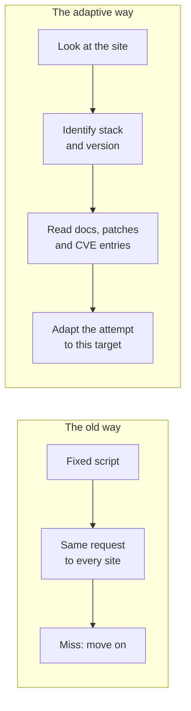

A server that answers a request tells you more than you would think. A header, an error page, a file path, the way a login form behaves. Put those clues together and you can often name the framework behind a site, and sometimes the version.

That has always been true. What used to limit many attackers was the effort that came after it. Reading the documentation for that version, finding the patch notes, working out which fix matters, and then bending an exploit to fit this one site. Doing that by hand for a thousand sites is a bad use of a week.

Many automated attacks were scripts. They fired the same request at every address they could find and moved on when it did not work. A script does not read. It does not notice that your site runs a slightly different version or sits behind a different proxy. It tries one thing, and if that thing misses, you never hear about it.

## What Changed

An AI agent can do the reading. It can look at a site, work out which technologies it uses, check whether a version is exposed, read the platform's documentation, look up recent patches and CVE entries, and then adapt an attempt to that specific target. The script does not have to stay fixed. It can be rewritten per site, quickly, by something that does not get bored on target two hundred.

I want to be careful here. I am not saying every attacker now has a perfect machine. I am saying the cost of a personalised attempt has dropped, and cost is what shapes how often something happens.

Here is the division of labour as I see it. The attacker still decides what is worth attacking and why. The AI supplies the volume: reading, matching, rewriting and retrying, many times faster than a person.

## React2Shell, or: Two Days

The clearest recent example is CVE-2025-55182, nicknamed React2Shell. The React team disclosed it on December 3, 2025, and it carries a CVSS score of 10.0. It is an unauthenticated remote code execution flaw in React Server Components. In plain words, one crafted HTTP request to a Server Function endpoint was enough, because of unsafe deserialisation in how React decodes the payload.

These details all come from the [React team's own advisory](https://react.dev/blog/2025/12/03/critical-security-vulnerability-in-react-server-components):

- **The affected versions:** `react-server-dom-webpack`, `react-server-dom-parcel` and `react-server-dom-turbopack` in 19.0, 19.1.0, 19.1.1 and 19.2.0. The fixes are 19.0.1, 19.1.2 and 19.2.1.
- **The reach:** Frameworks and bundlers that depended on or shipped the affected packages include Next.js, React Router, Waku, `@parcel/rsc`, `@vitejs/plugin-rsc` and `rwsdk`. Apps that never use a server, or a framework with Server Components support, are not affected.
- **The patch spread:** Next.js shipped fixes across several release lines, from 14.2.35 up to 16.1.5 in the latest update.
- **The reporter:** Lachlan Davidson reported it on November 29, 2025, through the Meta Bug Bounty.

CISA added it to the Known Exploited Vulnerabilities catalog on December 5, 2025, based on evidence of active exploitation. Google's Threat Intelligence Group reported that exploitation started shortly after disclosure and came from many directions: China-nexus espionage groups, and financially motivated actors dropping cryptominers. Amazon's threat intelligence team saw exploitation attempts within hours, and two days after the fix CISA had it on the list as actively exploited. I cannot tell whether AI was behind any of them. The window is the point: that is how much time an adaptive attacker has to work in.

After React2Shell came more issues: CVE-2025-55183 (information disclosure) and CVE-2025-55184 and CVE-2025-67779 (denial of service). The last one came from an incomplete patch for the one before it. Google's write-up recommended 19.2.3 for the denial-of-service fixes, but that patch turned out to be incomplete as well. A fourth issue, CVE-2026-23864, followed in January 2026, and React now lists 19.0.4, 19.1.5 and 19.2.4 as the safe versions.

Google also made a point I found reassuring. Many of the exploits that circulated in the first days did not work, and some samples carried malware aimed at the researchers trying them. Working exploits followed soon enough, though. Code that looks convincing is not the same as code that runs. That applies to what a machine writes as well.

## PHP Is Not Exempt

JavaScript is not the only place this happens. CVE-2024-4577 is an argument injection in PHP-CGI on Windows, caused by how a character gets mapped to something else (the "best fit" behaviour). It only bites in a narrow setup, PHP running in CGI mode or with the PHP binary exposed on Windows, which includes the default XAMPP configuration. Setups like that are often the ones nobody remembers to update, and Censys still counted 19,439 potentially vulnerable instances in March 2025, nine months after the fix.

Then there is the follow-up. A php-src advisory (GHSA-p99j-rfp4-xqvq) describes a bypass of that fix. It only works with a non-standard Windows OEM codepage setting in the registry, which the advisory itself calls unlikely in real environments. It shows how this goes, and React's follow-up issues above went the same way. A fix lands, people look at the fix, and the people reading it include the ones who want to see what it missed.

## Open Source Is Readable

This is the uncomfortable part, and it is not an argument against open source. The code is public, the commit history is public, and the fix for a vulnerability is public at the latest the moment it ships. A person can read a patch and reason backwards to the flaw, which is called patch diffing. An AI agent can do it faster. In Anthropic's own tests, its most capable model turned eight of 18 recent Firefox security patches into working exploits, the first in under an hour.

Closed products have bugs too. They give an attacker less to read, and Anthropic called that case substantially harder, but not out of reach: the same model built working exploit chains from compiled Windows kernel patches with no source code at all. Open source frameworks give away the full picture, which has always been the trade, and it is a good trade. The gap between "a fix exists" and "someone is using it against you" is getting shorter. That is not only an open source effect, and Mandiant's numbers predate most of this: its average time-to-exploit fell from 63 days in 2018 to five in 2023, though that figure excludes outliers. I wrote about one defender's answer to this in [Goodbye WordPress](/goodbye-wordpress-rebuilding-this-blog-with-ai/), where a static site meant no PHP at request time and no plugin to patch.

## It Is Not Hypothetical

In mid-September 2025, Anthropic detected a campaign in which a group that Anthropic assesses with high confidence to be Chinese state-sponsored, and tracks as GTG-1002, used Claude Code to try to infiltrate about 30 targets. They included large tech companies, financial institutions, chemical manufacturers and government agencies. A small number of attempts succeeded.

Per [Anthropic's own account](https://www.anthropic.com/news/disrupting-AI-espionage), the AI did roughly 80 to 90 percent of the work, with humans stepping in at around four to six decision points per campaign. The attackers got past the safeguards by splitting the job into small, innocent-looking tasks and telling the model it worked for a legitimate security firm doing defensive testing. Those numbers are Anthropic's, and some independent analysts question how much the AI really drove, partly because no indicators of compromise were published.

The same report has a detail that keeps this honest. The model sometimes invented credentials, or presented publicly available information as a stolen secret. That is still an obstacle to fully autonomous attacks. It is a shrinking one, I suspect, but it is real today.

## What I Take From It

I do not think the answer is panic. It is a few plain habits, which will sound familiar:

- **Know what you run.** If you cannot list your frameworks and their versions, you cannot tell whether an advisory is about you.
- **Patch faster than you used to.** Exploitation attempts against React2Shell were reported within hours of disclosure, and CISA had it on its exploited list two days later. That changes what "next sprint" means.
- **Reduce what you expose.** A version number in a header or an error page is a hint you do not need to hand out.
- **Check your dependencies.** I made the same point for commerce teams in [Secure Coding in Salesforce B2C Commerce Cloud](/secure-coding-in-salesforce-b2c-commerce-cloud/), where the platform secures itself but the code and libraries you add are yours.
- **Expect smarter bots.** On the storefront side, [The Bouncer at the Door](/the-bouncer-at-the-door-bot-protection-in-sfcc/) covers what a WAF catches and what it does not.

My view of AI has not moved since [AI as an Architect and Content Creator](/ai-as-an-architect-and-content-creator/): it supplies speed, and a person still supplies judgement. That holds on both sides of the fence. The speed is simply available to everyone now, and it is only the beginning.
