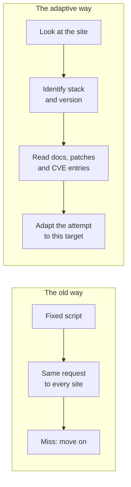

When this blog still ran on WordPress, I had a habit I never really thought about. A plugin update would come in, and somewhere in the back of my head a small clock started ticking. Not because I expected anyone to target me personally. Because I knew that once a fix is public, the hole it closes is public too.

That clock is running a lot faster now.

A server that answers a request tells you more than you would think. A header, an error page, a file path, the way a login form behaves. Put those clues together and you can often name the framework behind a site, and sometimes the version.

That has always been true. What used to protect many sites was the effort that came after it: reading the documentation for that version, finding the patch notes, working out which fix matters, and then bending an exploit to fit this one site. Doing that by hand for a thousand sites is a bad use of a week.

So most automated attacks were scripts. They fired the same request at every address they could find and moved on when it did not work. A script does not read. It does not notice that your site runs a slightly different version or sits behind a different proxy. It tries one thing, and if that thing misses, you never hear about it.

## What Changed

An AI agent can do the reading. It can look at a site, work out which technologies it uses, check whether a version is exposed, read the platform's documentation, look up recent patches and CVE entries, and then adapt an attempt to that specific target. The script does not have to stay fixed anymore. It can be rewritten per site, quickly, by something that does not get bored on target two hundred.

I want to be careful here. I am not saying every attacker now has a perfect machine. I am saying the cost of a personalised attempt has dropped, and cost is what decides how often something happens.

The diagram is my own picture of what these tools make possible, not a documented attack. The attacker still decides what is worth going after and why. The AI supplies the volume: reading, matching, rewriting and retrying, many times faster than a person could.

## What Is Happening Right Now

You do not have to look far for examples. The last year alone gave us a few in the most common web stacks out there.

**React and Next.js.** In December 2025 the React team disclosed a flaw in React Server Components, nicknamed React2Shell, that let one crafted request run code on the server. It scored the maximum 10.0, and because frameworks like Next.js ship Server Components, a lot of production sites were exposed through a dependency their owners never chose directly. The [React team's advisory](https://react.dev/blog/2025/12/03/critical-security-vulnerability-in-react-server-components) has the details. Amazon's threat intelligence team saw exploitation attempts within hours, and CISA listed it as actively exploited two days after disclosure. More fixes followed in the weeks after, partly because some of the first patches turned out to be incomplete.

**Node and npm.** In September 2025 a self-replicating worm called Shai-Hulud worked its way through the npm registry. It stole developer tokens, then used them to publish infected versions of other packages those developers maintained. [CISA reported](https://www.cisa.gov/news-events/alerts/2025/09/23/widespread-supply-chain-compromise-impacting-npm-ecosystem) more than 500 compromised packages. Nobody had to find a bug in your code. They only had to get into something your code installs.

**PHP.** CVE-2024-4577 let an attacker run code on PHP set up in CGI mode on Windows. What I find telling is where it came from. Back in 2012, PHP fixed a very similar argument-injection problem. Twelve years later, the researcher Orange Tsai showed that a Windows character-conversion feature, called "Best-Fit", could slip right past that old fix. The [php-src advisory](https://github.com/php/php-src/security/advisories/GHSA-3qgc-jrrr-25jv) walks through it, starting from the 2012 patch itself.

I cannot tell whether AI was behind any of these attacks. That is not really the point. The point is the pattern: a fix lands, people read the fix, and some of the people reading it want to know what it missed.

## Open Source Is Readable

This is the uncomfortable part, and it is not an argument against open source. The code is public, the commit history is public, and the fix for a vulnerability is public the moment it ships. A person can read a patch and reason backwards to the flaw. An AI agent can do it faster. In Anthropic's own tests, its most capable model turned eight of 18 recent Firefox security patches into working exploits, the first in under an hour.

Closed products have bugs too, and they give an attacker less to read. Anthropic called that case harder, not out of reach. Open source frameworks give away the full picture, which has always been the trade, and it is still a good trade. What changed is how quickly someone can act on what they read. It is one of the reasons I moved this blog away from WordPress, as I wrote in [Goodbye WordPress](/goodbye-wordpress-rebuilding-this-blog-with-ai/): no PHP running on request means one less thing to keep up with.

## It Is Not Hypothetical

In mid-September 2025, Anthropic detected a campaign by a group it assesses with high confidence to be Chinese state-sponsored. The group used Claude Code to try to break into about 30 organisations, including tech companies, financial institutions and government agencies, and succeeded in a small number of cases.

According to [Anthropic's own account](https://www.anthropic.com/news/disrupting-AI-espionage), the AI did roughly 80 to 90 percent of the work, with humans stepping in at a handful of decision points. The attackers got past the safeguards by splitting the job into small, innocent-looking tasks and telling the model it worked for a security firm doing defensive testing. Those numbers come from Anthropic, and some independent analysts have questioned how much the AI really drove.

The same report keeps it grounded. The model sometimes invented credentials, or presented public information as a stolen secret. That still slows attackers down today. I just would not count on it staying that way.

## What I Take From It

I do not think the answer is panic. It is a few plain habits:

- **Know what you run.** If you cannot list your frameworks and their versions, you cannot tell whether an advisory is about you.
- **Patch faster than you used to.** When exploitation starts within hours of a fix, "next sprint" is a long time.
- **Reduce what you expose.** A version number in a header or an error page is a hint you do not need to hand out.
- **Check your dependencies.** I made the same point for commerce teams in [Secure Coding in Salesforce B2C Commerce Cloud](/secure-coding-in-salesforce-b2c-commerce-cloud/): the platform secures itself, but the code and libraries you add are yours.
- **Expect smarter bots.** On the storefront side, [The Bouncer at the Door](/the-bouncer-at-the-door-bot-protection-in-sfcc/) covers what a WAF catches and what it does not.

My view of AI has not moved since [AI as an Architect and Content Creator](/ai-as-an-architect-and-content-creator/): it supplies speed, and a person still supplies judgement. That holds on both sides of the fence. The difference is that the speed is now available to everyone, including the people knocking on your door. The world is changing, and I think we are only seeing the start of it.
